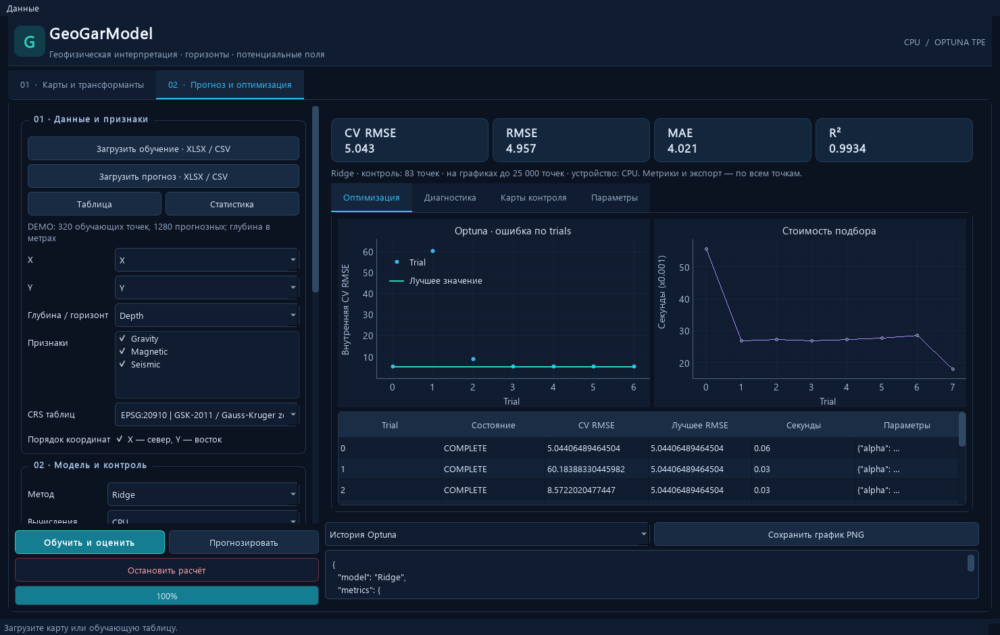
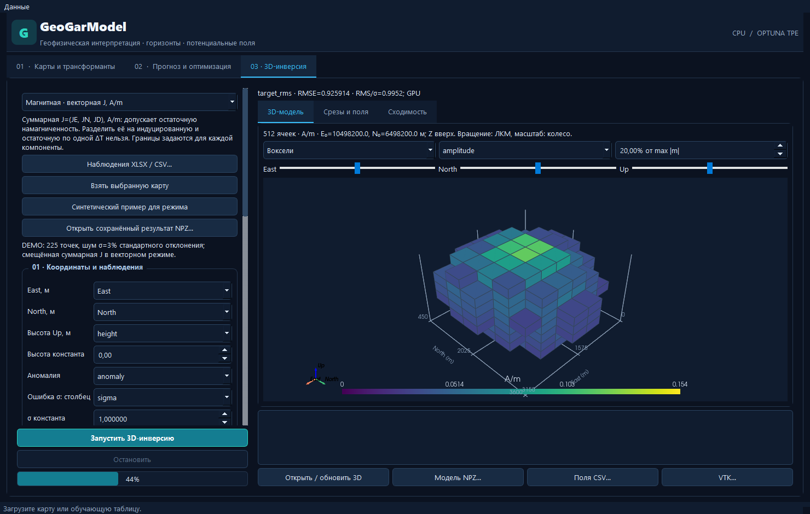

# GeoGarModel 2.3

Приложение на PyQt5 для совместной интерпретации потенциальных полей и сейсмических атрибутов по табличным данным.

На данный момент реализован функционал просмотра и редактирования grd, zmap файлов, расчет трансформант, обучение и прогнозирование базовой модели прогноза сейсмических горизонтов и трехмерная инверсия потенциальных полей.

Позже будут опубликованы видеоинструкции по синтетическим примерам.

[Общий проект](docs/PROJECTS.md) сохраняет **все три раздела**: карты и оформление,
ML/Optuna с обученной моделью и прогнозом, 3D-моделирование и все окна моделей.
Команда **Проект → Сохранить** (`Ctrl+S`), формат `.ggproject`.

[Интерфейс и расположение команд](docs/INTERFACE.md): настройки открываются по шагам,
дополнительные параметры и журналы - по стрелке ▸.

## Запуск

Python 3.11–3.13. В PowerShell из корня репозитория:

```powershell
# Установка Git на локальный ПК
winget install --id Git.Git -e --accept-source-agreements --accept-package-agreements
# Закрыть терминал и открыть заново
# Установка Python (строго 3.11)
winget install --id Python.Python.3.11 -e --accept-source-agreements --accept-package-agreements
# Закрыть терминал и открыть заново
# Можно проверить версии
git --version
python --version
# Вместо $Home можно задать свой "полный путь" куда импортировать репозиторий
# Например "cd C:\Users\User"
cd $HOME
# Импортируем репозиторий в выбранную папку (только main ветку)
git clone --single-branch https://github.com/Nikita18365/GeoGarModel.git
# Переходим в папку проэкта
cd GeoGarModel
# Создаем виртуальную среду и активируем её
python -m venv .venv или py -3.11 -m venv .venv
# Обновляем пакеты
.\.venv\Scripts\python.exe -m pip install --upgrade pip
.\.venv\Scripts\python.exe -m pip install -e ".[boosting,neural,geo,volume]"
.\.venv\Scripts\python.exe -m pip check
# Для проверки видеокарты можно ввести команду
# В выводе отобразится свободная память и тип GPU устройства
# При успешной проверке появятся название видеокарты и результат `5`. Для работы на CPU пропустите этот шаг.
nvidia-smi
.\.venv\Scripts\python.exe -m pip install -e ".[gpu]"
.\.venv\Scripts\python.exe -c "import cupy as cp; print('GPU:', cp.cuda.runtime.getDeviceProperties(0)['name'].decode()); print('Проверка GPU: 2 + 3 =', int(cp.add(cp.array(2), 3).get()))"
# Запуск программы
# При новом запуске терминала не забывайте перейти в рабочую дирректорию ($HOME)
cd "$HOME\GeoGarModel"
.\.venv\Scripts\python.exe -m geogarmodel
```

Для знакомства: «Данные → Открыть синтетический пример».



## Возможности

- Просмотр карт ZMAP/XYZ/NPZ: растровое отображение, изолинии, отмывка, обрезка,
  векторные наложения, экспорт. Выбор зон ГСК-2011 / Гаусса—Крюгера.
- Прогноз горизонтов: линейные методы, Random Forest, Extra Trees, sklearn boosting,
  MLP; опционально XGBoost, LightGBM, CatBoost, residual MLP и табличный Transformer.
- Optuna TPE: готовые и пользовательские диапазоны, внутренняя CV, pruning,
  история trials, найденные параметры и отдельный пространственный контроль.
- Ручной редактор гиперпараметров, загрузка JSON/отчёта; сохранение лучшего
  завершённого trial в JSON во время поиска и после остановки.
- Работа CPU/GPU у поддерживаемых моделей. Сам TPE выполняется на CPU;
  GPU-обучение требует совместимой сборки библиотеки и драйвера.
- Современная Qt-панель: живые графики RMSE, длительности, параметры,
  crossplot, распределение невязок и карты контроля. Экспорт CSV/JSON/PNG.
- Расчёт трансформант: Производные X/Y/Z/ZZ, горизонтальный градиент, аналитический сигнал, tilt,
  продолжение вверх, Gaussian-фильтры, региональное/локальное поле.
- 3D-плотностное моделирование по аномалиям силы тяжести,
  моделирования магнитной восприимчивости и векторной намагниченности с учётом
  возможного остаточного вклада на CPU/GPU.
- Интерактивная VTK-сцена: воксели, объём, изоповерхности, срезы и отсечение;
  сохранение/открытие NPZ и экспорт VTK/CSV.



## Документация

- [Проекты карт, слои, изолинии, SHP/GeoJSON и масштабная линейка](docs/MAP_PROJECTS.md)

- [Основная инструкция, форматы, координаты и трансформанты](docs/MODERNIZATION.md)
- [Прогнозирование сейсмических горизонтов, базовая модель, CPU/GPU, графики и экспорт данных](docs/OPTUNA.md)
- [Структура проекта и проверки](docs/ARCHITECTURE.md)
- [3D-плотностное и магнитное моделирование: входы, физика, CPU/GPU и визуализация](docs/INVERSION.md)
- [Импорт начальной модели и математические операции](docs/INITIAL_MODEL.md)
- [Подключение бота в Telegram для поулчения уведомлений о готовности инверсии](docs/TELEGRAM.md)

## Тесты разработчика

```powershell
python -m pytest -q
```

CI проверяет Windows/Linux и Python 3.11/3.13; отдельное задание устанавливает
дополнительные модели. GPU smoke-тест XGBoost включается переменной `GEOGARMODEL_GPU_TESTS=1` при наличии
CUDA GPU; Все расчеты GPU проверены локально на RTX 5060 Ti.

Исходный notebook от которого всё начиналось - `GeoGarModel v.1.1.ipynb`
Сведения о лицензировании — [LICENSE](LICENSE).

Контакты для связи:
- Почта - de.geophysicsnet.shop@gmail.com
- Telegram - https://t.me/NikitaARG73

