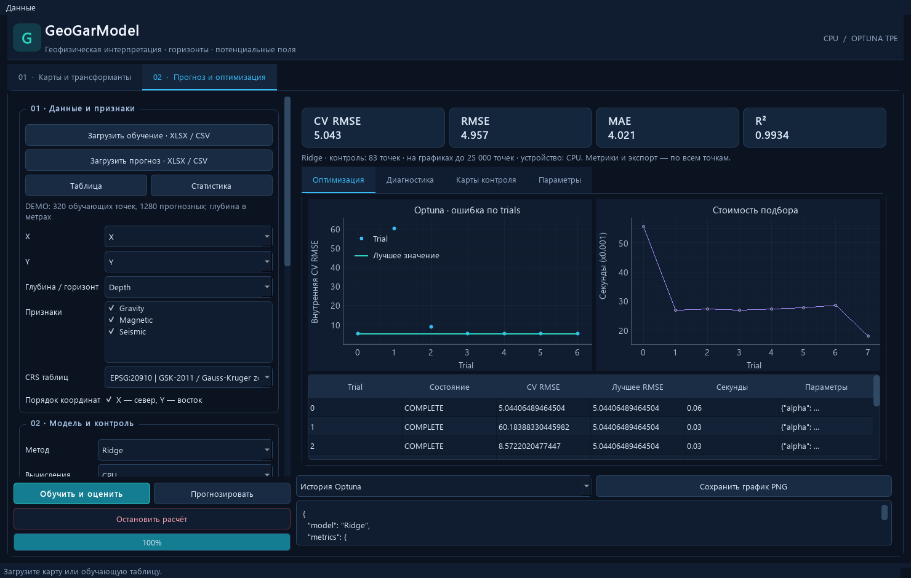
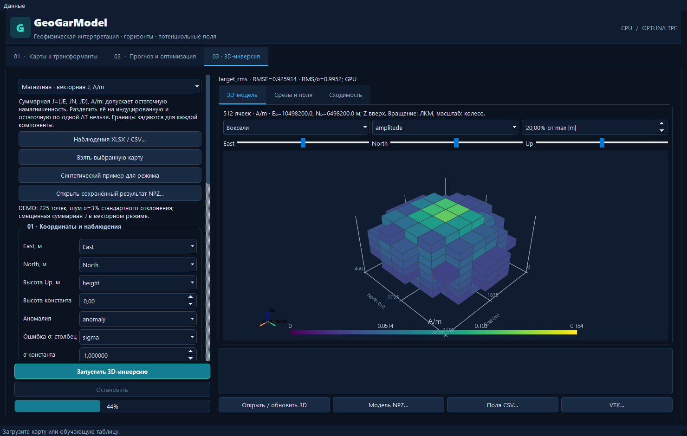

# GeoGarModel 2.3

Приложение PyQt5 для геофизической интерпретации потенциальных полей и прогноза
глубин опорных горизонтов по табличным геофизическим и сейсмическим атрибутам.

## Запуск

Python 3.11–3.13. В PowerShell из корня репозитория:

```powershell
python -m venv .venv
.\.venv\Scripts\Activate.ps1
python -m pip install -e ".[test]"
python -m geogarmodel
```

Дополнительные бустинги, PyTorch-сети и векторные карты:

```powershell
python -m pip install -e ".[boosting,neural,geo]"
```

Для знакомства: «Данные → Открыть синтетический пример».
После установки дополнительных моделей перезапустите приложение.



## Возможности

- Начальная модель: константа, UBC, VTK, центры ячеек, NPZ/предыдущий результат,
  три компоненты J; операции со свойствами и обрезка по поверхности с активной
  маской и пересечёнными призмами. Прямой Geosoft-импорт требует GX runtime.

- Прогноз горизонтов: линейные методы, Random Forest, Extra Trees, sklearn boosting,
  MLP; опционально XGBoost, LightGBM, CatBoost, residual MLP и табличный Transformer.
- Optuna TPE: готовые и пользовательские диапазоны, внутренняя CV, pruning,
  история trials, найденные параметры и отдельный пространственный контроль.
- Ручной редактор гиперпараметров, загрузка JSON/отчёта; сохранение лучшего
  завершённого trial в JSON во время поиска и после остановки.
- Выбор CPU/GPU у поддерживаемых моделей. Сам TPE выполняется на CPU;
  GPU-обучение требует совместимой сборки библиотеки и драйвера.
- Современная Qt-панель: живые графики RMSE, длительности, параметры,
  crossplot, распределение невязок и карты контроля. Экспорт CSV/JSON/PNG.
  На Windows 11 — тёмная системная рамка и заголовок окна.
- Карты ZMAP/XYZ/NPZ: растровое отображение, изолинии, отмывка, обрезка,
  векторные наложения, экспорт. Выбор зон ГСК-2011 / Гаусса—Крюгера.
- Производные X/Y/Z/ZZ, горизонтальный градиент, аналитический сигнал, tilt,
  продолжение вверх, Gaussian-фильтры, региональное/локальное поле.
- Отдельная 3D-инверсия: контраст плотности, индуцированная восприимчивость,
  векторная намагниченность с учётом возможного остаточного вклада. CPU/GPU,
  точная ΔT, ограничения свойств, глубинный индекс, гладкость и график сходимости.
- Интерактивная VTK-сцена: воксели, объём, изоповерхности, срезы и отсечение;
  сохранение/открытие NPZ и экспорт VTK/CSV. Установка: `pip install -e ".[volume,gpu]"`.



## Документация

- [Основная инструкция, форматы, координаты и трансформанты](docs/MODERNIZATION.md)
- [Optuna, CPU/GPU, графики и экспорт](docs/OPTUNA.md)
- [Структура проекта и проверки](docs/ARCHITECTURE.md)
- [3D-инверсия: входы, физика, CPU/GPU, визуализация и ограничения](docs/INVERSION.md)
- [Начальная модель, импорт вокселей, операции и обрезка по фундаменту](docs/INITIAL_MODEL.md)
- [Архив инструкции версии 1.1](docs/LEGACY_MANUAL.md)

## Проверки

```powershell
python -m pytest -q
```

CI проверяет Windows/Linux и Python 3.11/3.13; отдельное задание устанавливает
дополнительные модели. Внутренняя CV не использует внешние контрольные глубины.
GPU smoke-тест XGBoost включается переменной `GEOGARMODEL_GPU_TESTS=1` при наличии
CUDA GPU; проверен локально на RTX 5060 Ti 16 ГБ.

## Текущие границы

Сейсмические данные используются как табличные признаки; чтение SEG-Y и сейсмокубов
пока не реализовано. Табличный Transformer не является моделью сейсмических трасс.
Старые SHAP/Plotly-окна notebook не перенесены. 3D-инверсия использует конечную
воксельную область; совместная инверсия и подгонка
геометрии тел пока не реализованы. По ΔT восстанавливается суммарный J,
отдельное разложение на индуцированную и остаточную части не выдаётся.
Совпадение численных результатов трансформант с Oasis montaj не заявляется.

Исходный notebook `GeoGarModel v.1.1.ipynb` и исходные примеры сохранены.
Сведения о лицензировании — [LICENSE](LICENSE).


