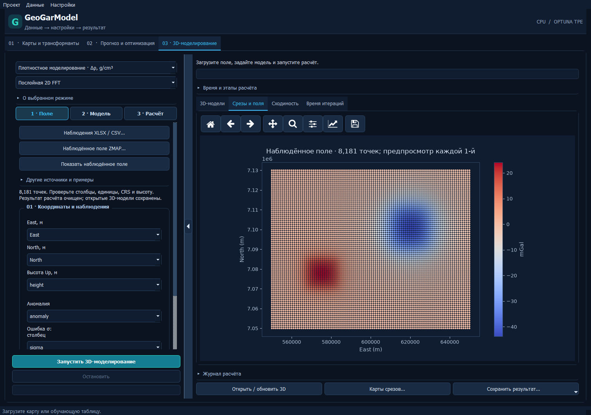
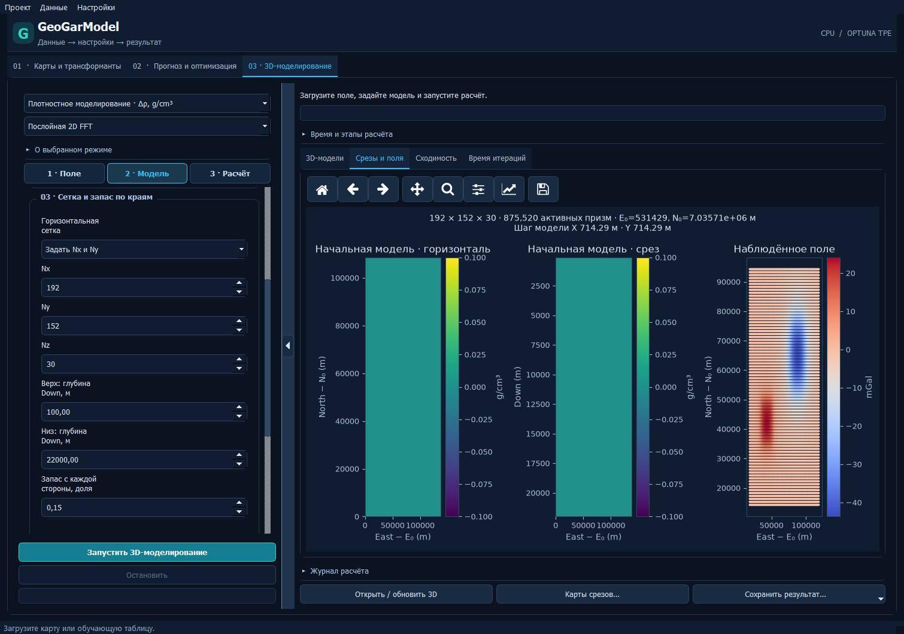
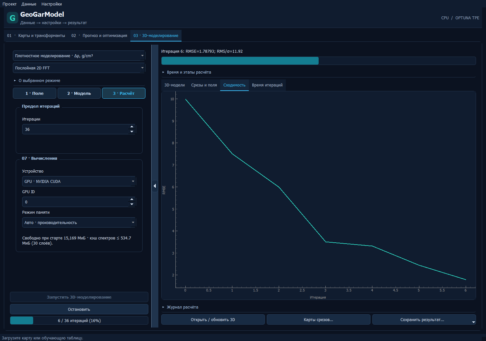

# 3D-плотностное и магнитное моделирование GeoGarModel

## Как сохранить большую модель после обрезки по поверхности

**Для дальнейшей работы в GeoGarModel** выберите **Сохранить результат… → Модель и поле → Быстрая модель (*.ggmodel)**.
Файл хранит свойства с исходной точностью, активность ячеек, наблюдения, рассчитанное поле, параметры и историю.
Для обычных ячеек достаточно общих осей сетки. Для ячеек с изменёнными границами записываются их индексы и фактические границы.
Обзор до 32 × 32 × 32 хранится отдельно. Горизонтальные слои записаны независимо, без сжатия.

1. Нажмите **Открыть результат…** и выберите файл. Сразу появится окно обзора с моделью и полем.
2. **Точный слой…** читает значения одного исходного слоя. Номер 1 соответствует верхнему слою. Векторное свойство показано модулем.
3. **Загрузить полностью** восстанавливает детальную геометрию для основного модуля и сохранения в проект.
   Файл можно также открыть через загрузку начальной модели. Для полной загрузки требуется оперативная память под весь куб и его геометрию.
4. Для обмена с прежними версиями выберите NPZ. Доступны сжатый архив и запись без сжатия.
   Для ParaView выберите VTK. Обрезанные призмы сохраняются точно в бинарном VTU порциями. Несжатый VTU может занять много места.

**Для Oasis montaj без подключения Python к Geosoft** откройте **Модель · UBC / Oasis montaj** и в списке типов выберите
**Комплект Oasis montaj**. Задайте имя новой папки. Для пересечённых ячеек программа покажет их количество.
Можно сохранить свойство в целой ячейке. В плотностной модели можно выбрать сохранение массы,
при котором контраст плотности умножается на долю оставшегося объёма. Это меняет геометрию источника и может изменить его поле.
Если границы активных ячеек совпадают с исходной сеткой, свойства и маска передаются точно.

Откройте проект Oasis montaj с рабочей папкой комплекта и выполните **Run Script → convert.gs**.
Сценарий обращается к штатной команде **UBC to Voxel**. Для скалярной модели результат называется
`model.geosoft_voxel`, для векторной — три отдельных файла JE, JN и JD (Down положителен вниз).
Проверьте назначенную СК по записи `crs` в `model.json`: сами файлы MSH и MOD не содержат определения проекции.
Если требуется вручную назначить СК или запустить импорт без сценария, откройте **Voxel → Conversions → UBC to Voxel**,
выберите `model.msh` и нужный `.mod`, задайте **Dummy value = -1e32**, укажите СК и путь выходного вокселя.
[Команда UBC to Voxel в справке Seequent](https://help.seequent.com/Oasismontaj/2025.2/Content/gxhelp/i/Geosoft_GX_VoxUtils_ImportUBCToVox.htm)

### GOCAD Voxet (.vo и .bin)

В меню **Сохранить результат… → Модель · GOCAD Voxet** укажите имя заголовка `.vo`.
Рядом появится бинарный файл `.bin`. Копируйте их вместе, сохраняя имя бинарного файла из строки `PROP_FILE`.
Для импорта откройте **Модель → Загрузить воксель / UBC / VTK / центры…** и выберите **.vo**.
Таким же способом Voxet можно загрузить из окна 3D-моделей. Для стороннего файла укажите физическое свойство и СК.
Значения сторонних файлов импортируются в исходных единицах: проверьте их до расчёта.

Экспорт поддерживает равномерный шаг по каждой из трёх осей (шаги X, Y, Z могут различаться).
Координаты — центры ячеек в метрах, Z — высота вверх, неактивные ячейки получают NoData.
Свойства записываются как RAW IEEE float32, старшим байтом вперёд; при необходимости сохранить float64 используйте GGModel.
Для векторной намагниченности три свойства JE, JN, JD записаны в один бинарный файл со своими смещениями.
Для частично обрезанных ячеек действуют те же правила ступенчатого приближения, что для UBC.
Импорт поддерживает RAW IEEE float32/float64 с `PROP_FILE`, `PROP_OFFSET` и `PROP_NO_DATA_VALUE`,
осевые перестановки и обращённые оси. Поворот относительно East/North, наклон и неравномерный шаг требуют переноса на осевую равномерную сетку.
Для файла с несколькими скалярными свойствами выберите нужное в диалоге.

### Плотность на кровле и срезах

В режиме **Воксели** цвет кровли и боковых граней показывает свойство открытых ячеек.
В плотностной модели это распределение плотности в г/см³. В магнитной модели шкала соответствует
выбранному свойству или компоненте. Для обзора неровной кровли поверните модель в изометрию.
Вертикальный масштаб регулируется в **Настроить вид → Пропорции модели → Растянуть Z**.

**Верхние призмы** — общая для вокселей, срезов и интерактивного отсечения настройка
от 0 до 100 %, по умолчанию 2 %. Доля отсчитывается от местной кровли по активным ячейкам
каждого столбца с округлением вверх. При 80 активных ячейках и 2 % подробно отображаются две верхние.
Их грани при плавной окраске сохраняют исходное свойство в центре. Цвет между центрами
и вершинами меняется плавно, в том числе на переходе к нижней части модели.
Рёбра по умолчанию скрыты. Для проверки сетки включите **Настроить вид → Палитры и оформление → Рёбра ячеек**.
Чтобы видеть одно значение на всю грань, отключите **Плавная окраска поверхности**.

- **Срезы XYZ**. Для горизонтального среза нажмите значок **Срез Z** и задайте глубину.
  Карта XY показывает только ячейки, пересекающие эту отметку. Пустоты остаются пустыми.
  Вертикальные срезы X и Y работают по тому же правилу.
- **Интерактивное отсечение**. Потяните маркер или задайте глубину числом.
  Цвет на плоскости показывает свойство активных ячеек на выбранной отметке. Рядом с процентом
  детализации указано число пересечённых видимых ячеек. Для ориентации в пространстве сохраняются
  внешние стенки модели. Чтобы увидеть только горизонтальную карту, используйте **Срез Z → Сверху XY**.

Если модель обрезана, например, по фундаменту, на малой глубине сечение может пересекать
только поднятия. Поэтому контур заполненной части карты может повторять очертания фундамента.
В каждой заполненной области шкала показывает плотность в г/см³. Если всем активным ячейкам задана
плотность 0,15 г/см³, все заполненные участки имеют один цвет при любой форме кровли.
По мере углубления площадь сечения может увеличиваться. Сравнивайте срезы по одной цветовой шкале.

Настройки сохраняются в проекте. Срезы и отсечение используют исходную сетку.
Для объёма и изоповерхностей больших моделей доступен облегчённый обзор.

## Экспорт намагниченности

В меню **Сохранить результат… → Намагниченность, А/м** выберите величину, затем **UBC (.msh)** или **GOCAD Voxet (.vo)**.

- **Эффективная (знаковая проекция)** сохраняет проекцию J на заданное направление за вычетом опорного значения. По умолчанию используются направление главного поля инверсии и нулевая опора. Для сравнения с REIST задайте направление и опору сравниваемой модели.
- **Модуль |J|** сохраняет длину вектора в каждой ячейке.
- **Три компоненты JE, JN, JD** сохраняет сетку UBC и три файла свойств или один заголовок Voxet с тремя отдельными файлами свойств JE, JN и JD. JD положительна вниз.

Для индуцированной модели программа сначала вычисляет J из восприимчивости и главного поля. GOCAD Voxet требует равномерного шага по каждой оси. При экспорте неравномерной сетки программа предлагает перенести свойства в центры равномерных ячеек с прежним охватом и числом ячеек. Для сохранения исходного шага можно использовать UBC.

В **3D-модели** выберите тип магнитного свойства и файл с любым базовым именем. Для векторного UBC можно указать три отдельных файла по порядку JE, JN, JD. Если бинарный файл Voxet был переименован или перемещён, укажите его при открытии заголовка .vo. Поддерживаются также VTU с осевыми прямоугольными призмами. При импорте VTU модель восстанавливается по фактическим границам призм.

## Результат и следующий запуск

По завершении расчёта открывается окно с вкладками **3D-модель** и **Рассчитанное поле**.
Поверните модель мышью. Чтобы заглянуть глубже, передвиньте ползунок **Верх среза** и отпустите его.
Для первого просмотра программа усредняет свойство по объёму активной части ячеек на сетке до 32 × 32 × 32.
Для векторной намагниченности показывается модуль вектора. Тонкие тела и точные очертания обрезки
лучше смотреть через **Открыть / обновить 3D** или **Карты срезов…** в основном окне.
Карта обзора показывает до 100 000 точек поля.

Нажмите **Сохранить…** в окне нужного расчёта. NPZ хранит полную модель и поле вместе.
Модель отдельно можно записать в UBC или VTK, поле во всех точках — в CSV, поле на регулярной
сетке — в ZMAP. Обзорное усреднение применяется только при показе.

После кнопки **Остановить** можно сохранить лучшую завершённую модель и соответствующее ей поле
и перейти к просмотру. При остановке до первой готовой оценки сохранять ещё нечего.
Следующую инверсию можно запустить с открытым первым окном. Каждое такое окно сохраняет
свой результат в оперативной памяти. Перед закрытием окна предыдущего расчёта сохраните его,
если хотите вернуться к нему позже. Последний результат можно снова открыть кнопкой **Обзор результата**.

После GPU-расчёта рабочий поток освобождает кэш оператора, планы FFT и свободные блоки памяти CuPy.
Ручная очистка для следующего запуска не требуется. Режим **Авто · производительность**
заново определяет объём свободной видеопамяти и отводит под кэш до 70% с учётом места для рабочих
массивов и фактического размера оператора. Драйвер и открытые графические окна могут занимать
часть видеопамяти между запусками.

## Кнопки и последовательность работы

Откройте модуль «03 · 3D-моделирование». Вверху выберите моделируемое физическое
свойство: плотность, магнитную восприимчивость или векторную намагниченность.
Слева три кнопки шагов: **1 · Поле → 2 · Модель → 3 · Расчёт**
(наблюдения → начальная модель и сетка → настройки расчёта). Кнопка шага открывает его; «Далее» переключает
к следующему. Кнопки запуска и остановки всегда находятся под шагами.
Настройки можно менять, возвращаясь к заголовкам; «Далее» само не запускает расчёт.

Дополнительные параметры раскрываются по стрелке ▸. Описание нового расположения
команд находится в [руководстве по интерфейсу](INTERFACE.md). Перечисленные ниже
экспорты модели и поля теперь собраны в меню «Сохранить результат…».

Во время расчёта все три кнопки шагов, «Далее» и прокрутка остаются доступными:
можно проверить назначенные столбцы, число ячеек, границы и настройки решателя.
Числовые поля доступны только для чтения (значения можно выделить и скопировать);
выбор параметров, загрузка данных и редактор модели заблокированы до завершения
или остановки расчёта. Активный шаг не влияет на выполняемый расчёт.

### Шаг 1: наблюдения

| Кнопка | Действие |
|---|---|
| Наблюдения XLSX / CSV… | Загрузить таблицу точек, затем явно назначить столбцы. Формат TXT также поддерживается. |
| Наблюдённое поле ZMAP… | Загрузить `.dat`/`.zmap` или NPZ карты. Все конечные узлы становятся наблюдениями; dummy исключается. |
| Взять выбранную карту | Взять текущий слой из модуля карт, включая его CRS; карта должна иметь метрические координаты. |
| Показать наблюдённое поле | Проверить карту после назначения столбцов. Это изображение измерений, не поле начальной модели. |
| Синтетический пример для режима | Заменить таблицу встроенным примером выбранной физики; выставить небольшую сетку и вернуться к модели-константе. |
| Открыть результат… | Открыть обзор GGModel или загрузить полный результат NPZ. |
| Далее → Начальная модель | Открыть шаг 2. |

### Шаг 2: начальная модель

| Кнопка / выбор | Действие |
|---|---|
| Константа на новой сетке | При запуске создать сетку по площади наблюдений, Nx/Ny/Nz, верху/низу и заполнить «Начальным значением». Файл модели не нужен. |
| Загруженная / отредактированная модель | Использовать существующие грани, свойства и активную маску. Параметры новой сетки не меняют этот воксель. |
| Загрузить воксель / UBC / VTK / центры… | Импортировать геометрию и свойства; UBC требует два файла. Форматы и зависимости — в [редакторе](INITIAL_MODEL.md). |
| Загрузить отдельно JE, JN, JD… | Выбрать три скалярных модели East, North, Down с одинаковой сеткой; переключить физику на векторную. Единицы A/m. |
| Использовать результат последнего моделирования | Сделать рассчитанные свойства начальной моделью нового запуска. |
| Предпросмотр модели и поля | Показать два среза начальной модели и карту наблюденного поля рядом. |
| Показать начальную трехмерную одель | Показать геометрию активных призм до расчёта. |
| Редактор вокселя… | Открыть отдельное окно необязательных операций; их нет в основном списке шагов. |
| Далее → Настройки расчёта | Открыть шаг 3. |

### Окно «Редактор начального вокселя»

| Кнопка | Действие |
|---|---|
| Операции со свойствами… | Константа, умножение, прибавление, диапазон, распределения, градиент глубины. Для J выбирается компонента. |
| Обрезать по поверхности… | Загрузить поверхность, указать Up/Down и оставить модель ниже либо выше. Удалённые ячейки не участвуют в моделировании. |
| Обрезка куба по XY с сохранением положения кровли и подошвы… | Введите минимум и максимум X (East) и Y (North) в метрах. Программа оставит части активных призм внутри прямоугольника. Каждая сохранит свои отметки кровли и подошвы и своё физическое свойство. Число слоёв по глубине сохранится. |
| Обрезать по прямоугольной области… | В шести отдельных полях задайте Xmin, Xmax, Ymin, Ymax, Zmin, Zmax внутри исходной сетки (глубина Down, м). Получится сплошной прямоугольный блок с горизонтальными кровлей и подошвой на заданных глубинах. Пустые ячейки получат нуль, пересекающиеся активные ячейки сохранят свойство на весь оставшийся объём. |
| Перенести на сетку Nx / Ny / Nz… | Пересчитать свойства на новую сетку, заданную на шаге 2; nearest или linear. Поле и масса могут измениться. |
| Отменить последнюю операцию | Вернуть предыдущую модель; это один уровень отмены с возможностью переключения обратно. |
| Сохранить начальную модель NPZ… | Сохранить подготовленную модель до запуска расчёта. |
| Готово | Закрыть редактор. Уже применённые изменения сохраняются; это не кнопка отмены. |

### Запуск и результат

| Кнопка / элемент | Действие |
|---|---|
| Запустить 3D-моделирование | Начать решение обратной задачи с текущими наблюдениями и начальной моделью. Во время расчёта изменение параметров блокируется, просмотр шагов доступен. |
| Остановить | Вернуть лучшую завершённую модель по RMS/σ и соответствующее поле; открыть окно экспорта. |
| Сходимость | RMSE по итерациям; журнал показывает также RMS/σ и функционал. |
| Срезы и поля | Срезы, распределение свойства, наблюдённое/расчётное/остаточное поля. |
| Открыть / обновить 3D | Показать **результат** моделирования (в отличие от кнопки начальной модели). |
| Модель NPZ… | Сохранить рассчитанную модель, данные, настройки, маску и историю. |
| Модель · UBC / Oasis montaj | Сохранить сетку и свойства. Для пересечённых ячеек выбрать правило ступенчатого приближения. |
| Поля CSV / ZMAP… | CSV: координаты, наблюдения, расчёт и невязка; ZMAP: рассчитанное поле на равномерной XY-сетке. |
| VTK… | Экспорт результата: VTR для полной сетки, VTU для обрезанных призм. |

В 3D "список режима" выбираются воксели, объём, изоповерхности, срезы XYZ или
интерактивное отсечение. `amplitude` означает |J|, East/North/Down — компоненты J;
для скалярных моделей выбор компонент отключён. Порог скрывает малые |m| только
при отображении вокселей. Ползунки меняют срезы XYZ; плоскость отсечения — только
визуализация, для изменения расчётной модели используйте редактор. У обрезанной
сетки «Объём» показывает полупрозрачные реальные призмы.

Панель над графиками: домик возвращает исходный вид, стрелки перемещают по истории
видов, крест со стрелками включает панорамирование, лупа — увеличение области,
ползунки/настройки изменяют оформление осей, дискета сохраняет изображение.
Эти кнопки меняют вид графика; NPZ-модель сохраняется отдельной кнопкой внизу.

## Подготовка данных: общая для всех трёх сценариев

Для расчетов требуются карт потенциальных полей, их координаты измерений и положение высоты датчика. Поправки при обработке поля силы тяжести и выделение
регионального фона выполняются до импорта. Для карты аномалий силы тяжести в редукции Буге заранее определите, какую остаточную
составляющую должна объяснять модель эффективной плотности.

CSV должен иметь строку заголовков. Пример данных для плотностного моделирования:

```csv
East,North,height,anomaly,sigma
500000,7500000,0,1.25,0.05
501000,7500000,0,1.41,0.05
500000,7501000,0,1.31,0.05
```

Это пример формата, не достаточная сеть для содержательной 3D-интерпретации.
Для моделирования магнитных свойств используется та же структура, но `anomaly` и
`sigma` задаются в nT. Названия столбцов могут
быть другими: в интерфейсе назначьте их вручную. Для ГСК обычно East=Y, North=X.
Координаты в метрах, одна зона/локальное начало для карты, вокселя и поверхностей.
CRS только маркируется и проверяется; сдвиг зонального префикса автоматически
не выполняется. Для зоны 18 выберите EPSG:20918 с учётом фактической записи XY.

В таблице нет высоты: «Высота Up, м» → «Константа», «Высота константа» → высота
плоскости съёмки относительно нуля модели. `0` допустим только при согласованном
нуле. При съёмке по рельефу назначьте столбец реальной высоты датчика Up. В ZMAP
содержится только поле, поэтому высоту и σ задайте константами либо подготовьте
CSV с высотами. Столбец σ, если выбран, имеет приоритет над константой.

σ — положительная ожидаемая ошибка поля в его единицах. Она задаёт вес точек и
критерий RMS/σ. Выбирайте по точности/шуму данных; примеры чисел ниже не являются
оценкой точности вашей съёмки. Начальные значения F/I/D в программе также
демонстрационные, для вашей площади их нужно заменить.

### Что означает «σ константа» на вкладке «1. Поле»

«σ константа» — одна предполагаемая стандартная погрешность для всех наблюдений.
При значении 1,00 программа использует 1 мГал для гравитационного поля или 1 нТл
для магнитного. Это вводимое допущение. Погрешность съёмки программа не измеряет.
Если выбран столбец σ, берутся значения из него.
В инверсии невязка каждого наблюдения делится на его σ. При σ = 1 и невязке 2 мГал
нормированная невязка равна 2. Если поставить σ = 2 мГал, та же невязка даст 1.
Вес в сумме квадратов пропорционален 1/σ². При одинаковой σ относительные веса
точек одинаковы. Изменение общей σ влияет на RMS/σ, на критерий остановки и на
отношение вклада невязки к регуляризации. Значение лучше брать из оценки шума
или повторных измерений. Для обеих единиц σ должна быть строго больше нуля.

## Послойная 2D FFT для магнитного поля

1. В разделе **3D-моделирование** выберите моделирование магнитной восприимчивости или векторной намагниченности, затем **Послойная 2D FFT**.
2. На странице **Поле** задайте аномалию полного магнитного поля и σ в нТл. Точки должны лежать на совместимой горизонтальной решётке на одной высоте. Допускаются пропуски узлов.
3. На странице **Модель** задайте размеры куба либо загрузите воксель. Для индуцированного режима свойства и их границы вводятся в СИ, для векторного — в А/м по компонентам East, North, Down.
4. В настройках задайте модуль главного поля в нТл, наклонение вниз и склонение от севера сетки к востоку. Выберите CPU или CUDA и запустите расчёт.
5. Чтобы получить индуцированную намагниченность из готового результата χ, откройте **Сохранить результат… → Индуцированная χ → намагниченность J, А/м…**. Полученный файл GGModel содержит три компоненты J и рассчитанное поле. Используются параметры главного поля сохранённой инверсии.

**Что рассчитывается.** Для каждого слоя программа преобразует в спектр аналитический магнитный тензор прямоугольной призмы, спроецированный на направление главного поля. Спектры свойств умножаются на спектры ядер и суммируются. Для градиента используются комплексно-сопряжённые спектры. Частично обрезанные ячейки учитываются напрямую по их фактическим границам. В индуцированном режиме J = χ B₀/μ₀ вдоль главного поля. В векторном режиме восстанавливаются три компоненты суммарной намагниченности. Одна карта допускает несколько таких распределений, поэтому особенно важны опорная модель и регуляризация.

FFT использует приближение слабой аномалии ΔT ≈ **f** · **b**, где **f** — единичный вектор главного поля, **b** — аномальное векторное поле. Оно применимо, когда модуль аномального векторного поля мал относительно главного. Для сильной намагниченности используйте прямой расчёт по призмам с точной разностью модулей.

## Послойная 2D FFT для плотностного моделирования

В разделе **3D-моделирование** выберите **Плотностное моделирование** и в списке
методов укажите **Послойная 2D FFT**.
Результат — трёхмерный куб эффективной плотности. FFT ускоряет расчёт поля
каждого горизонтального слоя и градиента по значениям плотности.

1. На странице **Поле** загрузите карту или таблицу. Укажите East, North, аномалию
   в мГал, метрическую СК и погрешность σ в мГал. Вводите одну абсолютную
   высоту Up в метрах для всей карты. Можно также выбрать столбец высот,
   если в нём одинаковое значение во всех строках. При переменной высоте
   программа покажет ошибку. Нулевая отметка высоты и глубины должна быть общей.
2. На странице **Модель** выберите константу или готовую плотностную модель.
   Для новой модели задайте верх, низ и число слоёв **Nz**. В списке
   **Горизонтальная сетка** выберите **По шагу карты** или **Задать Nx и Ny**.
   При ручном выборе Nx и Ny задают полное число ячеек, включая запас. Программа
   подбирает совместимый шаг ячеек, поэтому фактический охват может немного
   превышать запрошенный. Фактические шаги X и Y видны по кнопке
   **Предпросмотр модели и поля**. Для готовой модели используются её размеры
   и форма ячеек. Чтобы задать другие Nx, Ny и Nz, откройте **Редактор вокселя**
   и выберите **Перенести на сетку Nx / Ny / Nz**. Толщина слоёв готовой
   модели может меняться по глубине.
3. На странице **Расчёт** выберите CPU или NVIDIA GPU, номер GPU и режим
   памяти. **Сбалансированный** кэширует спектры в пределах 50% свободной
   памяти, **Производительность** — в пределах 70%. После выделения рабочих
   массивов фактический лимит может быть ниже. В режиме **Вручную** задайте
   предел в МиБ. Значение 0 отключает хранение спектров между расчётами поля
   и градиента. Журнал показывает размер рабочей FFT-сетки и число спектров,
   которые помещаются в кэш. Нажмите **Запустить 3D-моделирование**.
   Введите **Целевую RMS / σ** (по умолчанию 1) и предел **Итерации** (по умолчанию 100).
   Доступны ручная остановка, сохранение, карты срезов и объёмный просмотр.

### Подбор плотности по глубине

На шаге **Модель** задайте начальную плотность либо выберите готовый начальный
куб. Минимум и максимум ограничивают контраст плотности каждой активной ячейки
в г/см³. Кнопка **?** рядом с параметром открывает пояснение и диапазон ввода.

На шаге **Расчёт → Регуляризация и подбор шага** доступны глубинный индекс,
малость и гладкость. Индекс меняет относительную длину шага по глубине.
Малость управляет притяжением к опорной плотности. Гладкость штрафует разности
между активными соседями. В разделе **Опорная модель и регуляризация FFT**
выберите нужные ограничения.

| Настройка | Действие |
|---|---|
| Опорная модель | Нулевой контраст, начальная модель или отдельный воксель плотности. Для файла нужны совпадающие границы сетки по всем осям, включая запас, и одинаковая система координат. Проект сохраняет загруженный опорный воксель. |
| Вес малости | Равномерный, по глубине или по чувствительности. Вес по глубине равен `(zmin/z)^p` для центра активной ячейки. Вес по чувствительности равен нормированной норме столбца оператора, взвешенного по σ, в степени p. При подборе постоянного смещения учитывается удаление взвешенного среднего поля. Веса влияют на отклонение от опоры. Показатель 0…4, при 0 все веса равны. |
| Тип штрафа | L2 использует квадраты отклонений и соседних разностей. Компактный режим применяет сглаженную L1 к отклонению от опоры. TV применяет сглаженную L1 к разностям соседей отдельно по трём осям. Масштаб перехода ε задаётся в г/см³. Форма штрафа равна `ε (√(u² + ε²) − ε)`. |
| Множитель гладкости по Z | При 1 вес по Z равен базовому с поправкой на шаг сетки. При 0 соседние слои могут меняться независимо. Для проверки вертикального размытия сравните несколько значений при одной целевой RMS/σ. |
| Учитывать границы опорной модели | Если скачок опорной плотности между соседними ячейками достигает порога, решатель допускает разрыв и убирает штраф гладкости на этой грани. |
| Зафиксировать активные ячейки опорного вокселя | Для отдельного опорного вокселя можно жёстко задать известные плотности. Подготовьте маску только известных ячеек. В остальных активных ячейках опорой служит начальная плотность. Зафиксированные ячейки продолжают создавать поле. Полностью активный опорный куб фиксирует всю модель. |

**Ранняя остановка** включается на шаге **Расчёт**. В разделе **Параметры ранней
остановки** задайте минимальное улучшение RMS/σ в процентах и число последовательных
итераций. При срабатывании решатель возвращает модель и поле той завершённой
итерации, на которой RMS/σ была наименьшей. Причина остановки и номер выбранной
итерации сохраняются в результате.

**Запас с каждой стороны** считается от ширины карты вдоль соответствующей
оси. Например, доля 0,20 на карте шириной 100 км даёт минимум по 20 км с запада
и востока для новой модели. Чтобы дополнить готовый куб, включите
**Расширить загруженную модель** и задайте **Начальную плотность запаса**.
Добавляются только недостающие ряды активных ячеек. Внутренние плотности,
маска и обрезанные границы исходной модели сохраняются. Запас модели помогает
снизить влияние искусственной боковой границы на подбор плотности.
Циклическое наложение при свёртке устраняется отдельно, подбором размера
рабочей FFT-сетки.

Для FFT наблюдения и модель должны иметь соизмеримые шаги по X и Y. Модель
может быть мельче или крупнее карты. Допускаются постоянное смещение между
сетками, пропуски, нерегулярный контур и повторные измерения. Невязка вычисляется
в исходных точках. Для произвольных координат и профилей на разных высотах
используйте прямой расчёт по призмам. Если при ручных Nx и Ny рабочая
FFT-сетка требует слишком много памяти, попробуйте режим **По шагу карты**
или измените число ячеек.

Обрезка по поверхности сохраняется. Полные активные ячейки учитываются через
свёртку, для частичных призм рассчитывается вклад по их фактическим границам
в поле и градиент. При большом числе частичных призм этот этап может занять
значительную часть времени. Число таких призм видно в журнале запуска.

Контрольный запуск на RTX 5060 Ti 16 ГБ занял 65 с от создания оператора до
возврата результата. Синтетическая модель содержала 700×600×100 полных ячеек
размером 500×500×300 м. Для 100 000 узлов на одной высоте в поле двух тел
добавили шум с σ = 0,2 мГал. За 100 итераций с нулевой начальной моделью
RMS/σ снизилась с 31,80 до 1,17. Причиной остановки был заданный предел итераций.
Чтение исходных файлов, построение графиков и экспорт в замер не входили.

### Пример в интерфейсе

**Поле**



**Модель**



**Запуск**



## Сценарий 1: плотностное моделирование по аномалиям силы тяжести

Исходными данными обычно служит карта аномалий силы тяжести в редукции Буге 2.67 либо
подготовленная остаточная составляющая поля. Восстанавливаемое свойство — контраст
эффективной плотности Δρ в g/cm³.

1. Откройте «03 · 3D-моделирование», сверху выберите
   «Плотностное моделирование · Δρ, g/cm³».
2. Откройте «1 · Наблюдённое поле».
3. Для ZMAP нажмите «Наблюдённое поле ZMAP…», выберите `.dat`/`.zmap`.
   Для CSV нажмите «Наблюдения XLSX / CSV…», выберите таблицу и назначьте East,
   North, «Аномалия»; затем высоту/σ по столбцам или константами.
4. Для ZMAP проверьте East=East, North=North, «Аномалия»=anomaly;
   укажите постоянную высоту и σ. Проверьте, что поле действительно в mGal.
5. Выберите CRS, нажмите «Показать наблюдённое поле». Убедитесь, что XY и контур
   узнаваемы; перепутанные East/North дадут повёрнутую/переставленную геометрию.
6. Нажмите «Далее → Начальная модель». Если есть только поле, оставьте
   «Константа на новой сетке». Задайте Nx/Ny/Nz и предполагаемые вертикальные границы верх/низ.
   Глубины определяются вами, из поля они автоматически не вычисляются.
7. В «Свойства и ограничения» задайте начальное значение, например 0, и допустимые
   эффективные плотности в g/cm³. Пример диапазона −0.5…0.5 подходит только если
   соответствует вашей геологии. Отрицательный знак допустим.
8. Если начальный воксель уже есть: выберите «Загрузить воксель / UBC / VTK /
   центры…», укажите свойства плотности. Для UBC сначала mesh, затем model и
   явный dummy. Проверьте сводку и единицы. Nx/Ny/Nz загруженную сетку не меняют.
9. Нажмите «Предпросмотр модели и поля». При необходимости откройте «Редактор
   вокселя…», подготовьте модель, нажмите «Готово» и повторите просмотр.
10. «Далее → Настройки расчёта»: выберите CPU/GPU, число итераций, регуляризацию,
    глубинный индекс, целевую RMS/σ. Параметры главного магнитного поля в этом
    режиме скрыты.
11. Нажмите «Запустить 3D-моделирование». После завершения проверьте невязки и причину
    остановки; откройте 3D, сохраните «Модель NPZ…» и «Поля CSV / ZMAP…».

Постоянный сдвиг поля подбирайте только если это согласуется с подготовкой фона:
опция устраняет константу, но не заменяет региональное разделение. Хорошее
совпадение поля не гарантирует единственности распределения плотностей.

## Сценарий 2: моделирование магнитной восприимчивости

1. Сверху выберите «Моделирование магнитной восприимчивости · χ, SI».
2. На шаге 1 загрузите ZMAP кнопкой «Наблюдённое поле ZMAP…» либо CSV кнопкой
   «Наблюдения XLSX / CSV…». Укажите East/North и аномалию ΔT в **nT**.
3. Назначьте высоты, CRS, σ в nT и нажмите «Показать наблюдённое поле».
4. «Далее → Начальная модель»: оставьте константу, например χ=0, задайте сетку
   и глубины. Или импортируйте готовую модель **восприимчивости**, не плотности.
5. Минимум χ должен быть ≥0, максимум задайте по петрофизике. Например 0…0.1 SI
   — только демонстрационный диапазон. Значение 0.03 означает 0.03 SI, а не
   0.03×10⁻⁵. При других единицах явно преобразуйте свойства в редакторе.
6. Проверьте «Предпросмотр модели и поля», затем «Далее → Настройки расчёта».
7. В «Магнитное главное поле» введите F (nT), I (градусы вниз) и D (по часовой
   стрелке от севера **проекционной сетки**). Учитывайте сближение меридианов,
   если исходное D дано от географического севера. Автоматического IGRF-запроса нет.
8. Выберите CPU/GPU, итерации и регуляризацию. Нажмите «Запустить 3D-моделирование».
9. Проверьте рассчитанную ΔT, остатки и RMS/σ; «Открыть / обновить 3D» показывает
   распределение χ. Сохраните NPZ/CSV/VTK.

Этот режим предполагает J=χH вдоль главного поля. Если существенна остаточная
намагниченность с другим направлением, переходите к следующему сценарию.

## Сценарий 3: моделирование векторной намагниченности

Этот режим применяют, когда направление суммарной намагниченности может отличаться
от направления современного главного магнитного поля, в том числе при наличии
остаточной намагниченности.

1. Выберите «Моделирование векторной намагниченности · J, A/m».
2. Загрузите ту же подготовленную **скалярную 2Д карту ΔT** в nT через ZMAP или CSV
   и назначьте координаты, высоту, σ, CRS на шаге 1. Три карты Bx/By/Bz этот
   импорт не подразумевает: текущий функционал подбирает скалярную ΔT.
3. «Далее → Начальная модель»: для старта с нуля выберите константу и значение 0.
   Программа задаёт JE=JN=JD=0 во всех активных ячейках.
4. Если есть модель J: импортируйте векторный NPZ/VTK или нажмите «Загрузить
   отдельно JE, JN, JD…» и последовательно выберите три скалярных файла.
   Они должны иметь одинаковые грани/CRS; компоненты в A/m, JD вниз положительна.
5. Задайте ограничения каждой компоненты, например −1…1 A/m как тестовый диапазон.
   Это ограничения JE, JN, JD по отдельности, не ограничение |J|.
6. Проверьте начальную модель и перейдите к шагу 3. Введите F/I/D главного поля:
   они нужны и в векторном режиме для вычисления ΔT=|B0+Ba|−|B0|.
7. Выберите вычисления и параметры решателя, нажмите «Запустить 3D-моделирование».
8. В 3D переключайте amplitude, East, North, Down для просмотра модуля и компонент.
   Оцените поля/невязки, сохраните NPZ и CSV; при необходимости экспортируйте VTK.

Результат - **суммарная J**, допускающая отклонение от главного поля. Одной ΔT
недостаточно для однозначного разложения на χ и остаточную Jr. Программа не
выдаёт отдельно восстановленную остаточную составляющую. Для такого разложения
нужны независимые петромагнитные ограничения, которых эта постановка не вводит.

## Границы, контуры, пропуски: что допускается

Воксельная модель начинается с прямоугольного охватывающего объёма. **Область
наблюдений не обязана быть прямоугольной** и не обязана совпадать с гранями модели.
Прямой оператор использует координаты имеющихся точек; FFT-регулярность не нужна.

| Входная область | Что сделать и что происходит |
|---|---|
| Полная прямоугольная ZMAP | Загрузить напрямую; каждый конечный узел становится наблюдением. |
| ZMAP обрезана по произвольному контуру | Сохранить прямоугольный заголовок/массив ZMAP, снаружи контура записать штатный dummy. Импорт исключит эти узлы. |
| CSV уже обрезана по контуру | Оставить только строки существующих наблюдений, загрузить CSV и назначить столбцы. Заполнять внешний прямоугольник не нужно. |
| Карта с дырками внутри | В ZMAP дырки обозначить dummy; в CSV удалить строки с отсутствующим полем. Решатель подбирает оставшиеся точки, данных внутри дырок нет. |
| Нерегулярная площадная сеть / профили | Загрузить CSV конечных точек без интерполяции. Для создания новой площадной сетки нужен ненулевой размах обеих координат. Узкая сеть/один профиль слабо ограничивают 3D-структуру. |
| Только полигон SHP/GeoJSON | Это не измерения. Прямой кнопки маскирования наблюдений полигоном в этом модуле нет: предварительно подготовьте ZMAP с dummy или CSV с выбранными строками. |
| Несколько несвязанных участков | Можно загрузить вместе в одной CRS, но охватывающая модель заполнит также промежутки. Там ограничения слабые, а стоимость выше; рассмотрите отдельные задачи. |

### Куда нажимать, по кнопкам: полная прямоугольная 2Д карта наблюденного поля

1. Шаг 1 → «Наблюдённое поле ZMAP…» → выбрать карту.
2. Указать CRS, постоянные высоту и σ → «Показать наблюдённое поле».
3. «Далее → Начальная модель» → константа → Nx/Ny/Nz, верх/низ, запас.
4. «Предпросмотр модели и поля» → шаг 3 → настройки → запуск.

Запас задаётся долей горизонтального размаха, дополнительно добавляется половина
приблизительного шага ячейки. Поэтому даже при запасе 0 границы модели немного
шире крайних точек. Это уменьшает зависимость от искусственной боковой границы,
но не восстанавливает неизвестные внешние источники автоматически.

### Куда нажимать, по кнопкам: 2Д карта наблюденного поля обрезана по произвольному контуру

1. Подготовьте ZMAP: вне контура **dummy**, не числовой ноль; либо CSV только
   с точками внутри контура. Заголовок ZMAP должен соответствовать полному массиву.
2. Шаг 1 → загрузить соответствующей кнопкой → назначить координаты/поле/высоту/σ.
3. «Показать наблюдённое поле»: контур должен быть виден, наружных точек нет.
4. Шаг 2 → константа или загруженный воксель → «Предпросмотр модели и поля».
5. Шаг 3 → настройки → запуск. Восстановление опирается только на существующие точки.

**Контур карты автоматически не обрезает подземный воксель.** Новая модель
охватывает минимум/максимум конечных East/North прямоугольником. Для ограничения
источников используйте активную маску импортированной модели либо «Редактор
вокселя…» → прямоугольную/поверхностную обрезку. Вертикальная обрезка поверхностью
и маска области наблюдений решают разные задачи; произвольный полигон для куба
отдельной кнопкой пока не задаётся.

###  Куда нажимать, по кнопкам: дырки в данных и неполная сеть

1. В ZMAP обозначьте пропуски dummy из заголовка. В CSV заранее удалите строки
   NaN/Inf и служебные значения вроде −99999. В CSV они не распознаются как dummy.
2. Загрузите, назначьте столбцы → «Показать наблюдённое поле».
3. Проверьте отсутствие искусственных нулей/выбросов, задайте σ по реальной точности.
4. Создайте умеренную сетку, задайте регуляризацию и выполните диагностический запуск.
5. Оценивайте модель в пробелах как продолжение под действием регуляризации:
   низкая невязка на измеренных точках не подтверждает её внутри пробелов.

Ноль — реальное значение аномалии, а не отсутствие данных. Не дополняйте карту
нулями за контуром. Интерполяция для красивой карты не создаёт независимых
измерений. Прореживание «каждую N-ю строку» не является площадным усреднением:
при упорядоченной сетке оно может оставить полосы. Предпочтительно подготовить
пространственно равномерную выборку/огрублённое поле с учётом шага съёмки.

## Уведомления на телефон

Откройте **Настройки → Уведомления Telegram…**, подключите личного бота,
отправьте тест и включите нужные события. Сообщение содержит причину завершения,
время и RMS/σ выбранной модели. Файлы сохраняются отдельно в программе.
Подробная [инструкция подключения и настройки](TELEGRAM.md).

## Масштаб задачи и первая проверка

60×60×60 — 216000 параметров для скаляра, 648000 для J. Время зависит от числа
наблюдений, активных ячеек, CPU/GPU, кэша и числа пересчётов функционала.
Размер модели сам по себе не даёт достоверной оценки времени. Ранее приведённые
устные оценки «часы/недели» не являлись измеренным benchmark и не гарантируют срок.
Сначала выполните небольшую задачу на ограниченной области и 10 итерациях,
оцените время итераций и качество невязок. До первой записи iteration=0 оператор
может долго считать поле и градиент; отсутствие графика в этот момент не означает
само по себе зависание. Полная матрица всех точек и ячеек не кэшируется обязательно.

`target_rms` — достигнута выбранная RMS/σ; `iteration_limit` — закончились итерации;
`stationary` — обновление мало; `line_search_limit` — поиск шага не нашёл улучшения.
Последние три причины не подтверждают достижения требуемой ошибки.

Далее приведены установка, физика, единицы и параметры численного метода.

Третья вкладка «03 · 3D-моделирование» предназначена для плотностного моделирования,
моделирования магнитной восприимчивости и моделирования суммарной векторной
намагниченности.
Сейсмические горизонты для работы не требуются.

Начальные модели, UBC/Geosoft/VTK, операции и обрезка по фундаменту:
[подробная инструкция редактора вокселей](INITIAL_MODEL.md).

## Установка и первый запуск

CPU-решатель и срезы доступны в основной установке. Для интерактивной сцены
установите `python -m pip install -e ".[volume]"`. Для NVIDIA GPU:
`python -m pip install -e ".[gpu]"`. Extras можно объединить:
`python -m pip install -e ".[volume,gpu]"`.
GPU extra устанавливает CuPy и пользовательские библиотеки CUDA 12; совместимый
драйвер NVIDIA должен быть установлен отдельно. При ошибке GPU расчёт сообщает
о ней, автоматически на CPU не переключается. PyTorch для 3D-моделирования не требуется.

1. Откройте третью вкладку и выберите один из трёх режимов.
2. Нажмите «Синтетический пример для режима». Каждый режим создаёт 225 наблюдений
   от известного тела с шумом. Для векторного примера J не параллельна главному полю.
3. Проверьте CRS, высоту и границы модели. Параметры примера выставляются автоматически.
4. Выберите CPU или GPU, задайте итерации и нажмите «Запустить 3D-моделирование».
5. Следите за вкладкой сходимости. После завершения откроются срезы и поля.
6. Нажмите «Открыть / обновить 3D» для интерактивной модели.
7. Сохраните модель NPZ, поля CSV или VTK-модель. NPZ можно открыть повторно
   кнопкой «Открыть результат…».

## Данные, оси и единицы

Загружайте XLSX/CSV/TXT с заголовками и явно выбирайте столбцы **East**, **North**,
высоты наблюдения, аномалии и ошибки σ. Если высота или σ отсутствуют в таблице,
выберите «Константа» и задайте значение ниже. Столбцы высоты и σ имеют приоритет
над константой, когда выбраны. Пропуски/Inf не заполняются автоматически.
Для плотностного моделирования нужны аномалии силы тяжести в **mGal**; для
моделирования магнитных свойств — аномальное магнитное поле в **nT**.

Например:

```csv
East,North,height,anomaly,sigma
10500000,6500000,120,1.25,0.05
10500500,6500000,125,1.41,0.05
10500000,6500500,118,1.31,0.05
```

CRS должна быть метрической проекцией. В геодезических таблицах ГСК-2011 X часто
является севером: назначьте **North=X, East=Y**. Эти поля независимы от флажка
порядка осей на ML-вкладке. Зоны не смешиваются, перепроецирование не выполняется.

Высота наблюдений положительна **вверх** относительно выбранного нуля. Глубины
верхней и нижней граней модели положительны **вниз** относительно того же нуля.
В ядре используются East, North, Down и глубина наблюдений `-height`.
Все наблюдения должны быть строго выше верхней грани сетки. Переменная высота
поддерживается. Обрезка призм по поверхности доступна в редакторе начальной
модели; скважинные наблюдения внутри модели пока не поддерживаются.

Функция «взять выбранную карту» переносит конечные узлы текущего слоя с вкладки карт.
Перед переносом задайте карте правильные CRS/метры. Единицы поля проверьте
самостоятельно: значения не переводятся автоматически из μGal или тесла.
Высота после переноса задаётся константой. Не используйте производные/трансформанты
в качестве Δg или ΔT: для них требуется другой оператор.

Вход должен содержать подготовленные аномалии: главные/региональные поля и
необходимые поправки поля силы тяжести выполняются до импорта. Дополнительный
постоянный сдвиг можно подобрать опцией «Подбирать постоянный сдвиг поля».
Сдвиг выбирается взвешенным средним, согласованным с σ, и сохраняется в отчёте.

## Три физические постановки

| Режим | Восстанавливаемая величина | Ограничения |
|---|---|---|
| Плотностное моделирование | Контраст эффективной плотности Δρ, **g/cm³** | Задаваемый диапазон; допускаются оба знака |
| Моделирование магнитной восприимчивости | Восприимчивость χ, **SI**, без множителя 10⁻⁵ | Нижняя граница ≥0; J=χH вдоль главного поля |
| Моделирование векторной намагниченности | Суммарные JE, JN, JD, **A/m** | Отдельные компоненты могут иметь оба знака |

Для обоих магнитных режимов задаются F в nT, I в градусах (вниз положительно)
и D по часовой стрелке от **севера проекционной сетки**. Если берёте D из IGRF,
учтите сближение меридианов выбранной проекции. Автоматического запроса IGRF нет.
Используется постоянное главное поле на всей площади и μ0=4π·10⁻⁷ СИ.

Магнитная аномалия рассчитывается после суммирования трёх компонент всех ячеек:
`ΔT = |B0 + Ba| − |B0|`. Это нелинейный модуль суммарного поля, не сумма
индивидуальных модулей ячеек и не проекция Ba на фиксированное направление B0.
Саморазмагничивание и взаимодействие намагниченности между ячейками не учитываются.

Векторный режим допускает суммарную намагниченность, отклонённую от главного поля,
поэтому применим при наличии остаточной намагниченности. По одной скалярной ΔT
нельзя однозначно восстановить отдельно χ и остаточный вектор. Здесь результат —
**суммарный J**, его компоненты и модуль. Он не выдаётся за отдельно восстановленную
остаточную намагниченность. Для разложения нужны независимые петромагнитные данные.

## Сетка и параметры решения обратной задачи

Область по East/North определяется размахом наблюдений, параметром «Запас площади»
и половиной приблизительного шага ячейки с каждой стороны. Верх/низ задаются явно.
Увеличение области за пределы наблюдений уменьшает зависимость от искусственной
боковой границы, но само по себе не восстанавливает неизвестные внешние источники.

В каждой прямоугольной ячейке свойство постоянно. Прямая задача использует
аналитические интегралы по восьми вершинам, с устойчивыми логарифмами и арктангенсами.
Плотность не заменяется точечной массой; магнитное поле не заменяется диполем в центре.

Минимизируется функционал:

```text
J = 0.5 mean(((predicted − observed) / sigma)²)
  + 0.5 damping mean(m²)
  + 0.5 smoothness Σaxis mean((Δaxis m · hmin / haxis)²)
```

В векторном режиме регуляризуются три компоненты J. Начальная модель задаётся
константой (в векторном режиме одинаковой для всех компонент) или вокселем.
В базовой конфигурации L2 стягивает модель к нулевому контрасту. Послойная FFT
также поддерживает отдельную опору и веса, описанные в разделе о подборе плотности.
Численные значения весов зависят от выбранных единиц параметров модели: веса
для плотности не следует автоматически переносить на восприимчивость.

Решатель использует проекционный градиентный спуск, глубинную предобусловленность
и обратный поиск шага с проверкой уменьшения полного J. Глубинный индекс задаёт
вес `(z / zmin)^p`, нормированный по максимуму; z — расстояние от уровня самого
низкого наблюдения до центра ячейки. Он меняет приоритет обновления глубоких ячеек,
но не предоставляет измеренную информацию о глубине. Степень находится в [0,4].
Более сильный глубинный вес и ранняя остановка могут существенно менять модель.

«Масштаб первого шага» задаёт стартовый размер обновления; далее шаг адаптируется.
Границы свойств применяются на каждом шаге. Для векторного режима это границы
**каждой компоненты**, а не модуля J. Внешние наблюдения для независимого контроля
автоматически не выделяются: история RMSE относится к подбираемым данным.

Остановка: достижение RMS/σ (обычно около 1 для правдоподобной оценки σ), лимит
итераций, стационарность или исчерпание поиска шага. `iteration_limit` не означает,
что целевая точность достигнута. `stationary` также может означать активные границы
или слишком малые допустимые обновления.

### Ручная и ранняя остановка

Нажмите **«Остановить»** и дождитесь обработки текущего вычислительного блока.
Возвращается лучшая **завершённая** модель по минимальной RMS/σ из всей истории,
включая начальную модель (итерация 0). Неудачные пробные шаги не участвуют в выборе.
Вместе с моделью возвращается соответствующее рассчитанное поле, включая подобранный
постоянный сдвиг, если он был включён. При разных σ критерий учитывает их веса;
минимум обычной RMSE может относиться к другой итерации. Геологическая достоверность
этим критерием не оценивается. История сохраняется полностью, а номер возвращённой
итерации показывается над результатами и записывается в NPZ.

1. После остановки откроется окно **«Инверсия остановлена — сохранить результат»**.
2. Нажимайте кнопки экспорта и выбирайте файлы. Можно сохранить несколько форматов.
3. Нажмите **«Показать модель и поля»**: появятся срезы, карты и подготовленная 3D-сцена
   (переключитесь на «3D-модель» для её просмотра).
4. Если закрыть окно без сохранения, результат останется в памяти программы; экспорт
   доступен нижними кнопками. На диск автоматически ничего не записывается.

Если остановить расчёт до завершения оценки начальной модели, готового результата
ещё нет: программа сообщит об этом. Закрытие приложения/аварийное завершение не
равнозначно кнопке остановки; автоматических дисковых контрольных точек пока нет.

**Ранняя остановка** выключена по умолчанию. На шаге «Настройки расчёта» в блоке
«06 · Решатель и регуляризация» включите соответствующий флажок. Задайте
«Минимальное улучшение, %» (по умолчанию 0,1%) и «Последовательных итераций»
(по умолчанию 5). На каждой завершённой итерации проверяется
`(RMS_previous − RMS_current) / max(abs(RMS_previous), 1e-30)`.
Если улучшение меньше порога указанное число итераций подряд, расчёт завершается
со статусом `early_stop` и возвращает лучшую модель по RMS/σ. Рост ошибки также
считается отсутствием улучшения; заметное улучшение сбрасывает счётчик.
Параметр «Итерации» остаётся верхним пределом. Достижение целевой RMS/σ и другие
условия остановки продолжают действовать. После ранней остановки результат сразу
показывается в программе и сохраняется обычными кнопками экспорта.

### Форматы экспорта модели и поля

- **Модель и поле · GeoGarModel / NPZ** сохраняет геометрию, маску, свойства, поля, историю,
  настройки и причину остановки. Для быстрого повторного открытия выберите GGModel.
- **UBC…** — набор файлов: `.msh` (сетка), `.mod` (свойства), `.json` (CRS, единицы,
  dummy и номер выбранной итерации). Для векторной намагниченности создаются три
  отдельных файла `_JE.mod`, `_JN.mod`, `_JD.mod` в A/m, оси East/North/Down.
  Плотность — g/cm³, восприимчивость — SI. Неактивные ячейки имеют dummy `-1e32`:
  укажите его при обратном импорте. Порядок: глубина меняется быстрее всего,
  затем East, затем North; верх сетки записывается как высота Up.
  Пересечённые ячейки в UBC занимают полный объём. Для точного сохранения обрезки используйте GGModel, NPZ или VTU.
- **VTK…** — VTR для полной прямоугольной сетки, VTU для неактивных/обрезанных ячеек;
  геометрическая вертикальная ось — Up, компоненты `M_END` — East/North/Down.
- **Поля CSV / ZMAP… → CSV** — исходные точки East/North/height (Up, м), наблюдённое
  и рассчитанное поля, невязка «расчёт − наблюдения». Сохраняются все использованные
  в расчёте точки; единицы mGal для плотностного моделирования, nT для магнитного.
- **Поля CSV / ZMAP… → ZMAP** — только рассчитанное поле на равномерной XY-сетке
  минимум 2×2. Пропуски внутри сетки записываются как NULL, без заполнения контура.
  Произвольные точки, неравномерные оси или повторяющиеся XY требуют CSV; скрытой
  интерполяции нет. ZMAP — карта XY, высоты отдельных наблюдений не передаёт;
  для сохранения высот используйте также CSV/NPZ.

Эти форматы доступны и после обычного завершения расчёта.

## CPU/GPU, память и скорость

### Время и прогресс внутри итерации

После нажатия «Запустить 3D-моделирование» над вкладками результата показываются:

- Текущая итерация, номер пробного шага и этап: **Рассчитанное поле**, **Градиент**,
  **Регуляризация**. До них выполняется подготовка устройства и оператора.
- Число обработанных блоков и процент **текущего этапа**. Блок — пакет пар
  «наблюдения × активные ячейки», а не дополнительные итерации. Пустые блоки
  неактивных ячеек в счётчик не входят.
- Прошедшее время этапа и примерный остаток этого этапа по средней скорости
  уже обработанных блоков. После заполнения кэша или изменения скорости оценка уточняется.
- Общее прошедшее время, время текущей и последней завершённой итерации,
  ориентировочный остаток текущей итерации, время до заданного лимита итераций
  и прогноз полного времени.

Таймеры обновляются каждые 250 мс. Число блоков обновляется с ограничением частоты,
чтобы не перегружать интерфейс. На GPU учитывается завершение CUDA-работы,
а не только отправка команд устройству.

**Итерация 0** показывает время оценки поля, невязки и регуляризации начальной модели.
При первом расчёте поля программа также может заполнять кэш. Если начальная модель
уже удовлетворяет целевой RMS/σ, расчёт завершается на этом этапе.
Начиная с итерации 1, решатель вычисляет градиент в принятой модели и подбирает
длину шага. Для каждой попытки достаточно рассчитать поле и значение целевой функции.
При принятии шага решатель сохраняет рассчитанное поле для следующей итерации.
На вкладке **«Время итераций»** показана длительность каждой завершённой итерации
в секундах, включая начальную оценку 0. Точные значения также записываются в журнал.

Оценка оставшегося времени итерации и всего расчёта появляется после первой
завершённой итерации оптимизации. Она использует среднее последних пяти завершённых
итераций (без оценки 0). Если текущая итерация превысила это среднее, вместо ложного
нулевого остатка показывается ожидание новых замеров. Это прогноз до заданного
лимита, а не обещание времени завершения: число пробных шагов меняется, целевая
ошибка, ранняя и ручная остановки могут завершить задачу раньше.

Процент этапа сбрасывается при смене этапа и при новом пробном
шаге. **100% поля не означает 100% итерации**: число попыток подбора шага заранее
неизвестно. Нижний индикатор под кнопками отдельно показывает выполненные итерации.

После завершения/остановки общее время фиксируется до экспорта и визуализации.
В NPZ сохраняются `iteration_seconds`, `elapsed_seconds`, `trial_evaluations` для
строк истории; в настройках — `initial_evaluation_seconds`, `elapsed_seconds`
(решатель) и `run_elapsed_seconds` (с подготовкой оператора). При открытии нового
NPZ восстанавливается график времени. Старые NPZ без этих полей продолжают открываться.

CPU использует NumPy, GPU — CuPy/CUDA. Ядра и итерации выполняются в float64.
Вычисления идут в QThread, Qt/VTK обновляются из главного потока. Одновременный
запуск ML и 3D-моделирования блокируется. 3D-рендеринг использует графический драйвер
независимо от выбора вычислительного устройства решателя.

При выборе GPU для метода прямоугольных призм одно CUDA-ядро суммирует вклады
восьми вершин каждой призмы для каждой точки наблюдения. В плотностной задаче
оно вычисляет коэффициент вертикальной составляющей поля, в магнитной — шесть
компонент симметричного тензора. Режим включается автоматически.

**Контрольный замер для плотностной модели.** На RTX 5060 Ti с 16 ГБ памяти
использовали 256 наблюдений на разных высотах, сетку 16 × 16 × 8 и отключённый
кэш коэффициентов. Критерием окончания служила RMS/σ ≤ 1. Каждый вариант достиг
0,964943 за 8 итераций при 15 пробных шагах. Медиана трёх запусков после прогрева
составила 0,680 с для исходной версии, 0,679 с после удаления лишних вычислений
градиента и 0,223 с после замены CUDA-ядра. Для крупных сеток или при помещении
оператора целиком в кэш время до заданной RMS следует измерять отдельно.

Повторить контрольный замер из каталога проекта с установленным GeoGarModel:

```powershell
.\.venv\Scripts\python benchmarks/prism_rms.py --device gpu --cache-mb 0
```

Параметр `--cache-mb` задаёт лимит кэша в МиБ. Для замера на процессоре укажите
`--device cpu`. Первый запуск служит для прогрева, следующие три входят в медиану.

На шаге 3 в группе «Вычисления» выберите устройство и «Режим памяти»:

- **Авто · сбалансированный** (по умолчанию): кэш до 50% свободной памяти.
- **Авто · производительность**: кэш до 70% свободной памяти.
- **Вручную**: введите предел в «Кэш вручную, MiB». Значение 0 отключает кэш;
  ограничение 2048 MiB снято. Например, 10000 MiB можно указать на устройстве,
  где хватает свободной памяти после выделения резерва. Поле поддерживает и
  значения свыше 1 ТБ; распределения памяти между несколькими GPU нет.

Для CPU учитывается свободная оперативная память, для GPU — свободная VRAM
выбранного GPU ID. Проверка выполняется в рабочем потоке при каждом запуске.
Бюджет уменьшается с учётом оценённых рабочих массивов и резерва не менее
20% свободной памяти или 256 MiB. Кэш ограничивается также оценкой размера
полного оператора: маленькая задача не занимает весь разрешённый объём.
Если ручной предел требует больше доступного бюджета, расчёт выдаёт пояснение
до построения оператора; уменьшите предел или выберите автоматический режим.
Резерв — расчётная оценка, а не гарантия от нехватки памяти: другие приложения
могут занять память уже после старта. Кэш не выделяется целиком заранее.

В журнале и группе «Вычисления» показываются свободная память при старте,
бюджет кэша, оценка полного оператора и размер пакета. Эти данные сохраняются
в настройках результата NPZ. Изменение параметров применяется к новому запуску.

CPU обрабатывает пакеты до 64 наблюдений ×512 ячеек. GPU использует до 256
наблюдений за пакет, а число ячеек подбирается по свободной памяти; размер
пакета ограничен 1048576 парами. На малых задачах пакет меньше. Это снижает
накладные расходы множества маленьких запусков CUDA. Режим производительности
увеличивает бюджет кэша; адаптивные GPU-пакеты используются во всех режимах памяти.
100% загрузка GPU не гарантируется: скорость зависит также от размера задачи,
производительности float64, CPU, драйвера и наличия готовых блоков в кэше.

При заполнении кэша последующие блоки пересчитываются.
Полная матрица чувствительности обязательной не является. Магнитный блок хранит
шесть независимых компонент симметричного тензора. Число пар наблюдений/ячеек и
лимит кэша показываются при запуске. Кэш не включает остальные рабочие массивы
решателя, VTK и память CUDA-контекста.

Этот бэкенд работает с произвольными горизонтальными координатами и высотами.
Стоимость одного прохода прямого оператора растёт как Nнабл×Nячеек. Для плотностной
модели и регулярной плоской съёмки доступен отдельный режим послойной 2D FFT.
При работе с прямым оператором большие карты можно
проредить/огрубить с учётом шага данных; модель 200³ с полной картой может
потребовать неприемлемого времени даже без полной матрицы в памяти.

## Визуализация и сохранение

После расчёта вам будут доступны следующие элементы - график RMSE, два центральных среза, распределение свойств
и точечные карты наблюдённого, рассчитанного и остаточного полей с общими шкалами
для пары наблюдения/расчёт. Карты не добавляют новых измерений интерполяцией.

Интерактивная VTK-сцена предоставляет воксели с порогом по |m|, объёмную
визуализацию, набор изоповерхностей, ортогональные срезы и перемещаемую плоскость
отсечения. Для векторной модели выбирайте |J|, East, North или Down. Цветовая шкала
показывает единицы свойства. Геометрия сцены использует Up; локальный горизонтальный
ноль подписан в заголовке. Воксели и VTK-файл содержат полный результат; фильтр
отображения не меняет рассчитанную модель.

В 3D-сцене нажмите **«Настроить вид…»**: откроется отдельное окно настроек
читаемости, масштаба и цветов (также для начальной модели):

- **X / East, Y / North, Z / Up** — независимые коэффициенты визуального растяжения
  от 0,001 до 1000. Например, X=1, Y=1, Z=10 увеличивает вертикальный масштаб в десять раз.
  Координаты, размеры расчётных ячеек, свойства и экспорт при этом не меняются.
  Ввод числа применяется после Enter или перехода в другое поле. Камера вписывает
  растянутую геометрию, сохраняя текущий поворот. Если взгляд направлен точно вдоль
  изменяемой оси (например, «Сверху XY» при растяжении Z), включается изометрия,
  чтобы растяжение стало видно. Координата плоскости отсечения сохраняется.
- **Масштаб 1:1** — вернуть все коэффициенты к 1.
- **Подписи осей** — размер текста от 10 до 36 px; по умолчанию 18 px.
- **м / км** — единицы отметок на осях. East и North показывают исходные координаты,
  а внутреннее локальное начало E₀/N₀ используется только для точности графики;
  Z — высота Up относительно нуля модели.
  При растяжении отметки продолжают показывать реальные расстояния.
- **Изометрия / Сверху XY / Спереди XZ / Сбоку YZ** — стандартные ракурсы.
- **Вписать модель** — восстановить выбранный ракурс и поместить модель в окно.
- **Большое окно** — открыть развёрнутую 3D-сцену с текущими настройками,
  срезами и инструментом отсечения. При закрытии изменённые настройки, камера и
  глубина возвращаются в исходное внутреннее окно.
- **Палитры… / Библиотека палитр…** — тот же каталог с образцами и категориями,
  что и в 2D-картах: heat map, geophysics, monochromatic, topography,
  miscellaneous, включая 144 встроенные палитры. Импортировать архив не нужно.
  Начальная палитра — geophysics/colour.tbl. В списке также остаются «Авто»
  (viridis для неотрицательных значений, coolwarm для знакопеременных) и
  стандартные палитры.
  **Развернуть** меняет направление цветовой шкалы.
- **Авто диапазон** — исходная автоматическая шкала; **Симметрично ±** —
  от −max|m| до +max|m|; **Вручную** — введите «Мин.» и «Макс.» и нажмите
  **«Применить цвета»**. Минимум должен быть меньше максимума. Например,
  −0,2…0,3 g/cm³ для плотностной модели. Значения за пределами диапазона
  получают крайние цвета, ячейки не удаляются. Единицы соответствуют выбранному
  свойству/компоненте: g/cm³, SI или A/m.

Палитра и цветовой диапазон применяются к вокселям, объёму, изоповерхностям,
срезам и интерактивному отсечению; они копируются при открытии большого окна.
Цветовой диапазон не меняет свойства модели, порог отбора ячеек и экспорт.

Сцена использует параллельную проекцию. Колесо мыши приближает и отдаляет модель;
изменение размера подписей и единиц сохраняет выбранное приближение.

## Управление 3D-моделью и быстродействие

Откройте **3D-модели → Открыть / обновить 3D**. В каждом внутреннем окне
верхняя панель содержит компактные значки. Название действия появляется при
наведении мыши; цветная грань куба обозначает направление вида или сечения:

- **XYZ** — изометрия; **Сверху / Снизу**, **Спереди / Сзади**, **Справа / Слева** —
  виды с противоположных направлений; **Вписать** — восстановить охват модели
  в выбранном ракурсе. Смена ракурса не перестраивает воксельную сетку.
- **Срез X / Y / Z** — показать соответствующее сечение. В **Настроить вид… →
  Координаты сечений** можно ввести точные East, North и глубину Down в метрах;
  галочки «Показать» позволяют включить несколько плоскостей одновременно.
  Ползунки выбирают положение по доле диапазона. Точный ввод сохраняется при
  смене палитры; движение соответствующего ползунка снова задаёт положение по нему.
- **Палитры…** — каталог с видимыми образцами раскрасок.
- **Карты глубин…** — отдельные горизонтальные карты по заданным глубинам.
- **Настроить вид…** — компактные разделы пропорций, камеры, цветов,
  быстродействия, сечений и отсечения. **Большое окно** копирует текущие настройки.

В сцене: ЛКМ — вращение, средняя кнопка — перемещение, колесо — приближение.
Геометрия кэшируется при изменении настроек оформления. Модель показывается на
белом фоне с тёмными осями и цветовой шкалой. В 3D единицы шкалы обозначены
`g/cm³`, `SI`, `A/m`, в двумерных картах — соответственно г/см³, SI, А/м.

В **Палитры и оформление** доступны непрозрачность, рёбра ячеек, рамка,
плавная окраска поверхности и распределение цветов: линейное либо равная площадь
гистограммы. Доступны также дискретные цветовые зоны с заданным числом цветов и
**Использовать границы значений ZON**: абсолютные границы и цвета файла применяются
вместо автоматического диапазона (проверьте единицы свойства). Плавная окраска интерполирует свойства только для изображения;
исходные свойства, границы призм и экспорт модели не изменяются. Отключите её,
чтобы видеть отдельные значения ячеек. Порог вокселей по умолчанию равен 0 %,
поэтому показываются все активные ячейки; увеличение порога скрывает малые |m|.

В **Быстродействие** для режима «Воксели» задаётся доля поверхностных треугольников:
**во время движения** (по умолчанию 10 %) и **в неподвижном виде** (100 %).
Облегчённая поверхность готовится заранее, во время вращения переключается только
видимость объектов. Процент — целевая детализация внешней поверхности, а не доля
вычислительных ячеек; из-за сохранения топологии точное число может отличаться.
**Всегда полная детализация** отключает это упрощение. В объёмном режиме применяется
адаптивная выборка VTK, а сечения и изоповерхности используют свои геометрические
представления. **Качественная прозрачность** включает depth peeling при поддержке
графического драйвера. Первое построение большой модели может занять время;
дальнейшее вращение не пересчитывает физическую модель.

В **Пространственное отсечение** можно включить ограничение East/North/Down,
ввести минимальные и максимальные координаты и нажать **Применить отсечение**.
Это визуальное отсечение, не операция редактора исходного вокселя. Для режима
«Интерактивное отсечение» можно выбрать нормаль X, Y или Z и двигать плоскость
мышью. По Z всегда остаётся часть **глубже плоскости**: начинайте с верхней
границы и погружайте плоскость вниз. Поворот нормали плоскости мышью отключён,
чтобы случайно не поменять сторону отсечения. После отпускания мыши глубина
появляется в числовом поле и сохраняется при смене палитры и растяжении осей.

### Направление глубины и качество сечений

При первом открытии модели Z-сечение и горизонтальное отсечение начинают от
верхней границы сетки. **Down, м** увеличивается вниз; геометрическая ось сцены
остаётся Up. Это одно правило для внутреннего и большого окна.
В режиме сечений или горизонтального отсечения под значками видна строка
**Поверхность — ползунок — Глубина**. Движение ползунка вправо увеличивает глубину;
для точного положения введите число в метрах. После перехода в большое окно и
возврата положение сохраняется. Если верх сетки находится выше обрезанной
поверхности, на самых малых глубинах сечение может быть пустым — погрузите его
до активных ячеек.

Для плавной окраски сечения используется текстура высокого разрешения.
Интерполируется **свойство в плоскости сечения до применения палитры**,
а не готовые RGB-цвета. Одинаковый способ используется для X/Y/Z в 3D и
горизонтальных карт. Он учитывает неравномерные размеры ячеек и сохраняет
пустоты и реальные обрезанные границы. Интерполяции между слоями по глубине в
горизонтальной карте нет. Текстура облегчает вращение и не меняет исходный куб.
Снимите **Плавная окраска поверхности** в настройках 3D или **Плавная окраска**
в окне карт, чтобы видеть исходные постоянные значения ячеек.

### Несколько 3D-окон и моделей

Рабочая область **3D-модели** содержит внутренние окна: их можно перемещать,
изменять в размерах, сворачивать, разворачивать и закрывать стандартными кнопками
в заголовке. Двойной щелчок по заголовку разворачивает окно. Щёлкните один раз
по нужному окну или выберите его в верхнем списке. Слева появятся его модели.
При перемещении указателя выбор сохраняется.
Чтобы задать своё имя, щёлкните правой кнопкой по заголовку и выберите
**Переименовать окно…**. Эта команда также доступна по правому щелчку
на списке окон. Имя сохраняется в общем проекте.
В узких окнах число отметок осей и размер подписей автоматически уменьшаются.

1. Нажмите значок **Загрузить 3D-модель с диска…** в общей верхней панели.
   Выберите тип свойства: плотность (г/см³), восприимчивость (SI) либо векторная
   намагниченность (А/м). Для NPZ тип читается из файла. Затем выберите модель:
   NPZ, UBC mesh + свойства, поддерживаемый VTK или таблицу центров.
   Для VTK выберите cell-массив, для UBC — файл свойств и при необходимости dummy.
   Загрузка выполняется в фоне. Эта команда добавляет модель для просмотра и
   не заменяет начальную модель расчёта. Координаты не перепроецируются.
2. Модель добавится в окно, выбранное в момент запуска импорта. Пока файл
   читается, можно работать в другом окне. Если исходное окно закрыто до
   окончания загрузки, модель появится в списке **Все загруженные модели**.
   При первом импорте окно создаётся автоматически.
   Для отдельного окна нажмите значок **Новое 3D-окно**, затем загрузите файл
   либо добавьте модель из общего каталога.
3. В списке **Все загруженные модели** выберите источник и нажмите соседний «+».
   В каталоге виден путь; у выбранной модели он также указан в поле
   **Источник выбранной модели** (его можно выделить и скопировать; подсказка
   показывает полный путь). Для UBC показываются mesh и файл свойств.
   Несохранённые модели обозначены как находящиеся в памяти.
4. Внутри одного окна может быть несколько моделей. Щёлкните по имени слева,
   чтобы переключить отображение. В каждом окне показывается одна выбранная
   модель; для одновременного сравнения разместите модели в разных окнах.
   Палитра, диапазон, ракурс, растяжение и положения сечений запоминаются
   отдельно для каждой модели каждого окна.
5. Значки **Расположить окна рядом** и **каскадом** управляют расположением.
   Список окон в общей панели позволяет открыть ранее свёрнутое окно.
   Правый щелчок по имени модели → **Убрать модель из этого окна** не удаляет
   исходный файл и не убирает модель из других окон или общего каталога.

Общий каталог уникален по полному пути, типу свойства и выбранному массиву
(для UBC — файлу свойств). Повторное добавление того же источника использует
уже загруженную модель; модели в памяти различаются как отдельные результаты.
Закрытие одного окна освобождает его графическую сцену, но сохраняет источник
в каталоге для других окон. Изменение таблицы наблюдений не закрывает эти окна.
Набор окон, все загруженные модели и настройки просмотра сохраняются вместе
с остальными разделами через **Проект → Сохранить** (`.ggproject`).
Подробно: [общие проекты](PROJECTS.md). Экспорт отдельной численной модели
остаётся отдельной командой.

## Карты горизонтальных срезов на заданных глубинах

1. Откройте результат инверсии либо начальную модель в 3D. Нажмите **Карты
   глубин…** в панели 3D. Для результата есть также кнопка **Карты срезов…**
   под вкладками: она работает без установленного пакета volume.
2. Выберите способ:
   - **Свои глубины**: например `500; 1500; 3000`. Допустимы одна, две, три
     и больше глубин. Разделитель — точка с запятой или пробел; десятичная запятая
     внутри числа поддерживается.
   - **Каждый N-й слой**: задайте верхнюю/нижнюю границы и N. Внутри диапазона
     выбираются центры слоёв, начиная с первого попавшего слоя; N=1 — все слои.
   - **Диапазон с шагом, м**: например верх 1000 м, низ 5000 м, шаг 500 м.
     Первая глубина равна верху, последующие увеличиваются на шаг; нижняя граница
     включается только если попадает в эту последовательность.
3. Глубина задаётся как **Down**, в метрах, положительная вниз, в пределах сетки.
   Верх должен быть не глубже низа; шаг > 0; предел — 10 000 срезов.
4. Нажмите **OK**: откроется отдельное окно карт. Выберите 1–3 карты на странице,
   переходите кнопками «Назад / Далее». На каждой карте есть координаты East/North,
   подпись глубины, цветовая шкала и единицы свойства. Общие палитра и диапазон
   берутся из настроек 3D-вида на момент открытия окна, чтобы сравнивать глубины.
5. Для векторной намагниченности используется выбранная компонента: amplitude —
   модуль, East/North/Down — соответствующая компонента, в А/м.
6. Кнопка дискеты сохраняет текущую страницу. **Сохранить все карты в PDF…**
   последовательно выводит все страницы с индикатором прогресса. Экспорт можно
   остановить: PDF будет содержать уже сохранённые страницы. Растровые части PDF
   сохраняются с разрешением 300 dpi. Большой экспорт может занять время.

Срез берёт свойство реально пересекаемой активной ячейки, без интерполяции по
глубине. На общей горизонтальной границе выбирается слой ниже; на самом нижнем
уровне модели — последний слой. Учитываются обрезки по поверхности и частичные
XY-границы призм. Неактивные ячейки и участки выше срезанной поверхности пустые,
а не нулевые. Если на глубине нет активных ячеек, карта показывает соответствующую
надпись. Постраничное построение не создаёт одновременно тысячи изображений.
Галерея использует исходную модель: визуальный порог вокселей и временное
отсечение сцены XYZ не ограничивают карты. Реальные обрезки модели, выполненные
в редакторе вокселя, учитываются.

NPZ содержит границы ячеек, модель, наблюдения, поля, историю, σ, настройки физики,
CRS, устройство и причину остановки. Повторное открытие предназначено для анализа
и отображения. Через блок начальной модели NPZ можно использовать для новой
моделирования; состояние старого алгоритма не продолжается. Векторные компоненты
в NPZ и VTK `M_END` имеют порядок East/North/Down; геометрическая Z-ось VTK — Up.
CSV хранит поля и невязки без сокращения точек. VTK VTR открывается в ParaView.

